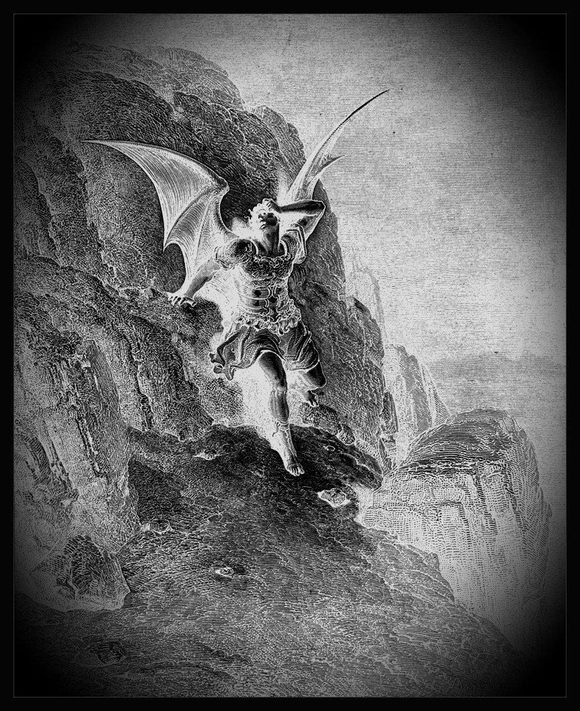

  

**I build small tools, alone, in black and white.**

Self-taught, with no team, no roadmap and no colour — Python, HTML, and a machine that can be made to do more than it should. Everything here exists because I wanted it to, and because a program, done properly, is a drawing.

That is most of what you will learn about me. The rest is in the work.

  

  <i>“The mind is its own place, and in itself can make a Heaven of Hell, a Hell of Heaven.”</i> 
  Paradise Lost · Plate I, after Gustave Doré

---

### 01 — WORK

**[TAOS · Steam Achievement Unlocker](https://github.com/0XYZK1/TAOS-Steam-Achievement-Unlocker)** · `python` · `windows`  
A minimalist Steam achievement manager. It reads your real local progress and writes it back through Steamworks — no web login, no API key, no browser automation.

**[Warframe.Market · Bumper](https://github.com/0XYZK1/Warframe.Market-Bumper)** · `html` · `automation`  
Keeps your buy and sell listings at the top of the market, quietly, while you do something else.

More exists in private. Not everything wants to be seen.

---

### 02 — METHOD

`python` · `html` · `css` · `javascript` · `pywebview` · `steamworks` · `local models` · `image models`

AI is the brush, not the author. Everything is built alone, slowly, until the form feels right. When a tool deserves it, I take it apart and leave it better than I found it.

Colour is noise. Noise is not style. A tool should read like one clean line.

---

### 03 — OPEN

Have an idea for a tool? Say it.

I take requests, ideas and corrections — open an issue on anything here, or find me wherever I am. If it interests me, I'll build it.

**Not a company. Not a service. One person who likes making things.**

---

  T A O S &nbsp;·&nbsp; THE ART OF SOFTWARE &nbsp;·&nbsp; © 2026 XYZK

